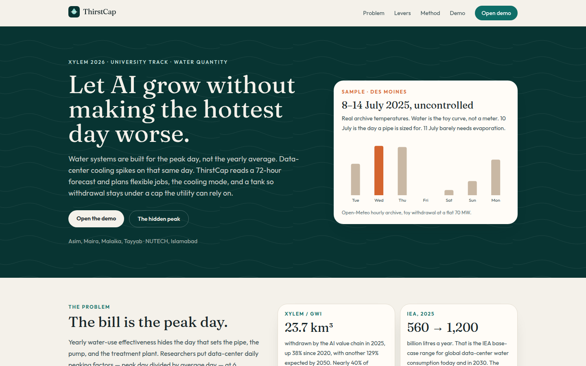
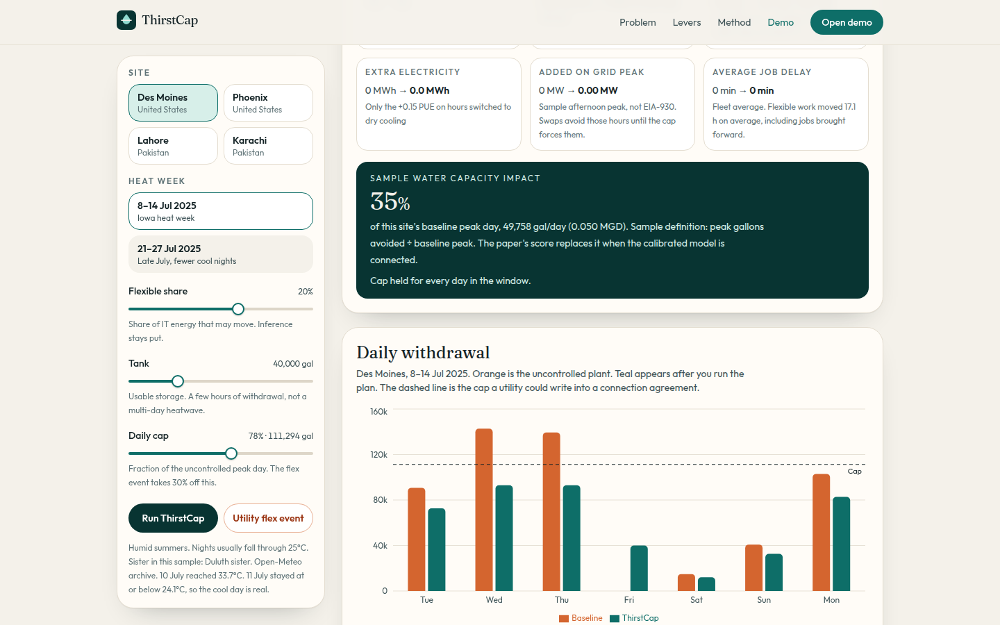
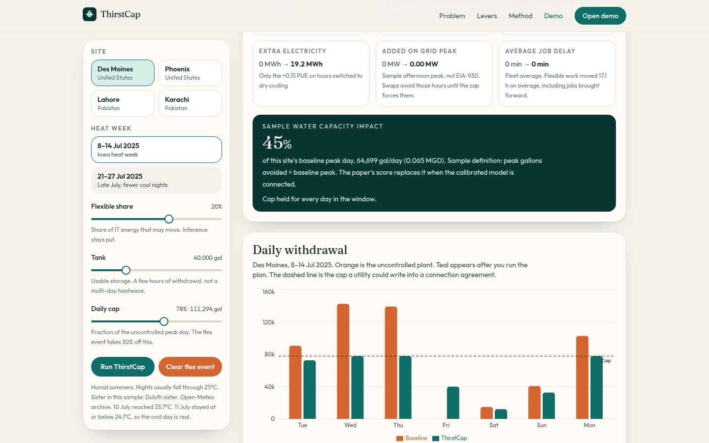
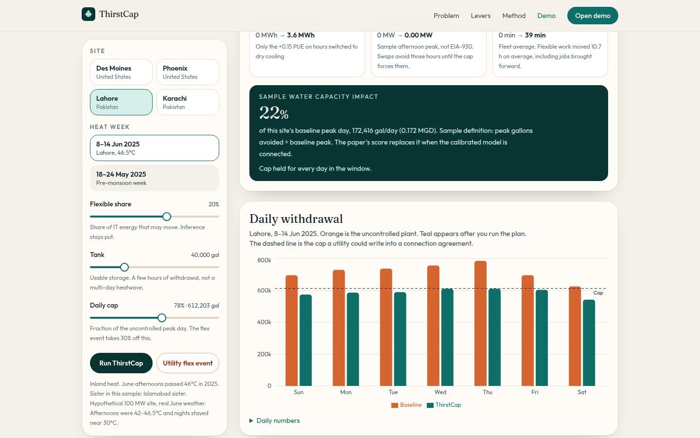
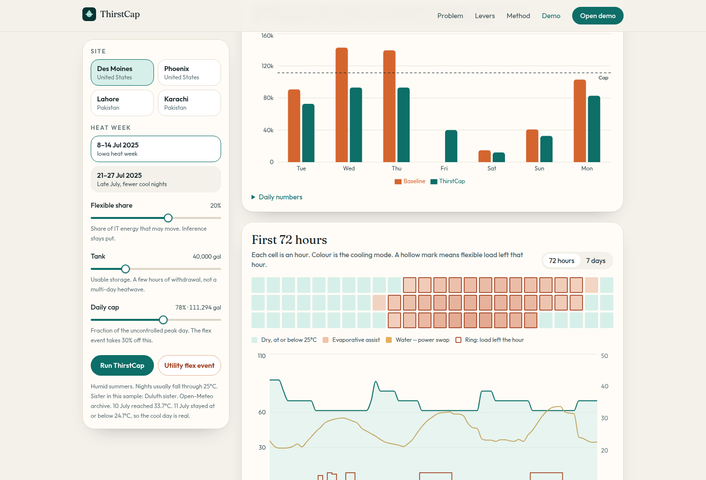
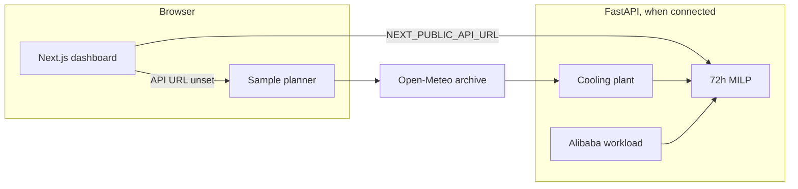

# ThirstCap

ThirstCap is a 72-hour planner that keeps a data center’s water withdrawal under a **peak-day cap** a utility can build around. It is the University Track entry from Asim, Maira, Malaika, and Tayyab at NUTECH, Islamabad, for the [Xylem Global Student Innovation Challenge 2026](https://xyleminnovationchallenge-platform.bemyapp.com/), Problem Statement 1, Water Quantity.

Water systems are sized for the hottest day, not the yearly average. Cooling water for data centers spikes on that same day — often six to ten times the average day, against about 1.5–2.5 for other large users ([Han, Li, Wierman, Ren, 2026](https://arxiv.org/abs/2603.02705)). ThirstCap reads the weather 72 hours ahead and moves four levers together: when flexible jobs run, which site runs them, whether the plant evaporates or spends electricity to stay dry, and when a tank fills or draws. A utility **water flex event** tightens the cap the way a power demand-response call tightens load.

This repository is the frontend. It runs today on a labelled sample planner so the demo works before the optimizer exists. The service that replaces that planner is specified in [BACKEND.md](BACKEND.md).

## Screenshots



The opening argument: a real July 2025 week in Des Moines under the toy cooling curve. One day spikes. The next barely evaporates.



After **Run ThirstCap**, the daily bars fall under the cap and flexible load leaves the hot hours.



A flex event cuts the cap by 30% and the sample planner buys a small amount of dry cooling to hold it.



The same tool on a hypothetical 100 MW site with Lahore’s June 2025 weather. Sister-site gallons stay on screen.



The first 72 hours: cooling mode by hour, and IT load leaving the hot afternoon.

## What is real, and what is a sample

| Real in this demo | Sample, and labelled on screen | Not claimed |
| --- | --- | --- |
| Hourly dry-bulb temperatures from the [Open-Meteo archive](https://open-meteo.com/en/docs/historical-weather-api) for eight weeks in 2025 | A flat 70 MW load inside a 100 MW plant | A saving at any operating facility |
| The toy cooling curve from the team brief: evaporation starts at 25°C and reaches 1.8 L/kWh at 40°C | Flexible share, tank size, sister pairing, and the flex signal | That the browser planner is the MILP |
| The product interaction: cap, four levers, flex event, before/after | A sample afternoon grid shape, not EIA-930 | Video numbers. Those wait for the calibrated backtest |

Do not copy gallons, megawatt-hours, or minutes from the demo into the project page or the video. The brief is explicit: those figures come from the final backtest only.

The 11 November 2026 toy check (time-shift alone, full year, not this dashboard) is quoted on the overview page and nowhere else:

| Site | Days needing evaporative assist | Peak-day cut from time-shift only | Days that need a swap to halve the peak | Extra electricity |
| --- | ---: | ---: | ---: | --- |
| Des Moines | 112 | 13% | 11 | 171 MWh/yr (0.03%) |
| Phoenix | 244 | 4% | 88 | 4,586 MWh/yr (0.68%) |
| Lahore | 254 | 6% | 34 | 1,333 MWh/yr (0.20%) |
| Karachi | 343 | 7% | 115 | 3,611 MWh/yr (0.54%) |

## Run it locally

```bash
npm install
npm test
npm run dev
```

Open [http://localhost:3000](http://localhost:3000). The demo is [http://localhost:3000/dashboard](http://localhost:3000/dashboard). `npm test` checks the sample planner: the peak does not rise, Iowa uses time-shift, Phoenix uses space-shift, a flex event tightens the cap, and water stays non-negative.

No environment variables are required. The sample planner is on whenever `NEXT_PUBLIC_API_URL` is unset.

```bash
# .env.local, only after the FastAPI service from BACKEND.md is deployed
NEXT_PUBLIC_API_URL=https://thirstcap-api.onrender.com
NEXT_PUBLIC_USE_MOCK=false
```

`NEXT_PUBLIC_*` values are inlined at build time. Set them, then run `npm run build` again or redeploy.

## Deploy to Vercel

1. Push this repository and import it at [vercel.com/new](https://vercel.com/new). Framework preset: **Next.js**. Root directory: the repository root. No install or build overrides.
2. Leave the environment empty for the sample demo the judges can click immediately.
3. Deploy. The site is static enough to be fast: the sample planner runs in the browser.
4. When the optimizer exists, add `NEXT_PUBLIC_API_URL` and `NEXT_PUBLIC_USE_MOCK=false` for Production, then redeploy. The FastAPI service must allow this site’s origin. See [BACKEND.md](BACKEND.md).

Bind nothing yourself. Vercel sets `PORT`. This app does not write to local disk.

## Architecture



The browser ships eight weeks of archive temperatures so the demo works offline. With an API URL set, `POST /v1/plan` and `POST /v1/sensitivity` replace that planner. Both paths return the same JSON. The UI reads `meta.sample` and refuses to present a sample payload as a live result.

Pages:

- `/` — the problem, the sourced facts, the four levers, the toy check, and the line between real and simulated.
- `/dashboard` — site, heat week, sliders, Run ThirstCap, utility flex event, metric cards, daily water, 72-hour plan, sensitivity, and the Pakistan weeks.

## Demo path

The dashboard follows the team’s demo script.

1. Des Moines, 8–14 July 2025, is already selected. The orange bars are the uncontrolled plant.
2. Press **Run ThirstCap**. Flexible load leaves hot hours. The teal bars are scored against the dashed cap.
3. Read the six cards: peak-day gallons, peak-day WUE, window peaking factor, extra MWh, megawatts on the sample grid peak, average job delay.
4. Press **Utility flex event**. The cap drops 30% and the plan resolves. **Clear flex event** restores it.
5. The sensitivity panel varies flexible share from 5% to 30% with swaps turned off, and compares a perfect temperature series with a synthetic cool bias.
6. Choose Lahore or Karachi for the hypothetical 100 MW Pakistan case. Sister-site water stays visible.

Phoenix is the week where time-shifting has little room, because the nights never fell through 25°C.

## Sources

Facts on the overview page link out to the primary source. The set includes Xylem/GWI, the IEA, the 2026 peak-capacity paper, WRI Aqueduct, the Pakistan 2,000 MW announcement, WaterWise, and the Open-Meteo archive. Past [Ignite winners](https://www.xylem.com/en-us/sustainability/community/xylem-ignite/innovation-challenge/videos/) paired a local water–energy problem with something a person could operate. ThirstCap keeps that shape and aims it at data-center peak water, which that library does not cover.

## Team

Asim, Maira, Malaika, Tayyab. Software engineering students, NUTECH, Islamabad, Pakistan. University Track, Water Quantity. Credit mentors or teachers who help before submission on the project page.

## License of the data

Open-Meteo weather is used under its published terms. The sample planner and the interface in this repository are the team’s work for the challenge.
