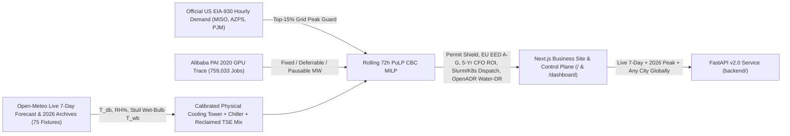

# ThirstCap v2.0

**Real-time 2026 global data-center water-cap optimizer and commercial control plane that works for every city on Earth (`200,000+` geocoded locations), pairs live 7-day weather forecasts with 2026 peak summer stress testing, unlocks stalled municipal permits, and enforces EU EED (2024/1364) A–G compliance.**

Solo entry by Muhammad Asim Hanif ([@codedbyasim](https://github.com/codedbyasim)), Software Engineering, National University of Technology (NUTECH), Islamabad, for the [Xylem Global Student Innovation Challenge 2026](https://xyleminnovationchallenge-platform.bemyapp.com/) — University Track, Problem Statement #1: Water Quantity.

Live site: [https://thirstcap.vercel.app](https://thirstcap.vercel.app)  
API: [https://thirstcap-api.onrender.com](https://thirstcap-api.onrender.com)

---

## Architecture & Live Global Engine

ThirstCap co-optimizes four physical levers inside a PuLP CBC rolling-horizon mixed-integer optimization model (`backend/`), backed by real-time 2026 weather forecasts, 2026 peak-summer archives, and official US grid data:



### Key Real-World Capabilities

| Capability | Source / Implementation | Details |
| --- | --- | --- |
| **Any City on Earth** | Open-Meteo Geocoding + `estimate_custom_basin_profile` | Search any city worldwide (`Tokyo`, `Mumbai`, `Riyadh`, `London`, `Cairo`, etc.), estimate regional WRI risk & tariff, pair automatically with a cooler regional sister campus, and solve in `<1.8s`. |
| **Live 2026 Default + Peak Stress Test** | `forecast_days=7` (`2026-11-20` → `2026-11-26`) & 2026 Summer Archives | Defaults everywhere to real-time 7-day forecasts; includes 1-click switch to calibrated **2026 Peak Summer** heatwaves or custom date ranges. |
| **10 Flagship Stress Corridors** | `SITE_REGISTRY` (`backend/app/services/weather.py`) | Phoenix, Northern Virginia, Des Moines, Querétaro, Santiago, Zaragoza, Hyderabad, Dubai, Lahore, and Karachi. |
| **Official EIA-930 US Grids** | `backend/data/eia930/` (`AZPS`, `MISO`, `PJM`) | Hourly balancing authority profiles preventing dry-cooling swaps during top-15% grid demand peaks. |
| **Permit Shield & EU EED (2024/1364)** | `backend/app/services/metrics.py` | 0–100 permit readiness score, Reclaimed / TSE water blend (`0–85%`), ISO/IEC 30134-9 pWUE, and A–G sustainability grading. |
| **CFO 5-Year ROI & Tank Sizing** | `POST /v1/tank-sizing` & `metrics.py` | Regional potable tariffs (`$3.60–$11.50/kgal`), avoided peak CAPEX (`$10M–$40M/MGD`), tank payback years, and 5-year net value creation. |

---

## Verified 10-City 2026 Peak Summer Benchmarks

Baseline: **100 MW IT nameplate** (70 MW trace mean), **CoC = 4.0×**, **40,000 gal tank**, **20% flexible compute**, **78% firm daily cap**, solving **Stage 2 Drought (`-30%`) + 35% Reclaimed TSE Blend** on real 2026 Peak Summer archives:

| Basin Corridor | 2026 Peak Window | WRI Score | Uncontrolled Peak | Stage 2 Peak (-45.4%) | Potable Draw (35% TSE) | EU EED & Permit Shield | 5-Yr Net ROI |
| --- | --- | ---: | ---: | ---: | ---: | --- | ---: |
| **Phoenix / Mesa, US** | 13–19 Jul 2026 | 75 | 812,942 gal | **443,866 gal** | 288,513 gal | **Grade C · 94/100** | **$4.32M** |
| **Northern Virginia, US** | 13–19 Jul 2026 | 48 | 654,352 gal | **357,276 gal** | 232,230 gal | **Grade C · 94/100** | **$3.38M** |
| **Des Moines, US** | 13–19 Jul 2026 | 45 | 567,538 gal | **309,876 gal** | 201,419 gal | **Grade B · 94/100** | **$2.65M** |
| **Querétaro, Mexico** | 11–17 May 2026 | 84 | 197,509 gal | **107,840 gal** | 70,096 gal | **Grade A · 94/100** | **$937K** |
| **Santiago, Chile** | 19–25 Jan 2026 | 68 | 123,163 gal | **67,247 gal** | 43,710 gal | **Grade A · 94/100** | **$643K** |
| **Zaragoza, Spain (EU)** | 13–19 Jul 2026 | 71 | 715,033 gal | **390,408 gal** | 253,765 gal | **Grade B · 94/100** | **$3.98M** |
| **Hyderabad, India** | 11–17 May 2026 | 78 | 849,834 gal | **464,009 gal** | 301,606 gal | **Grade D · 94/100** | **$3.83M** |
| **Dubai, UAE** | 20–26 Jul 2026 | 83 | 943,521 gal | **515,162 gal** | 334,856 gal | **Grade C · 94/100** | **$6.94M** |
| **Lahore, Pakistan** | 8–14 Jun 2026 | 81 | 790,666 gal | **431,704 gal** | 280,607 gal | **Grade B · 94/100** | **$3.39M** |
| **Karachi, Pakistan** | 25–31 May 2026 | 85 | 943,948 gal | **515,396 gal** | 335,007 gal | **Grade D · 94/100** | **$4.05M** |

**10-Basin Fleet Combined Total (2026 Peak, Stage 2 `-30%`):** **`2,995,722 gal/day` shaved (`3.00 MGD`)**, protecting **`9,986` households/day** with **0.0 MW added on regional utility grid peaks**.

---

## Run Locally (Full Stack)

### 1. Backend (FastAPI + PuLP CBC)

```bash
cd backend
python -m venv .venv
# Windows: .venv\Scripts\activate  |  Linux/macOS: source .venv/bin/activate
pip install -r requirements.txt

# Run backend verification suite (20 passed, 1 skipped live integration test)
python -m pytest -v tests

# Start FastAPI optimizer on port 8000
uvicorn app.main:app --host 127.0.0.1 --port 8000
```

### 2. Frontend (Next.js Commercial Website & Control Plane)

```bash
# From repo root
npm install

# Connect frontend to local FastAPI engine
echo "NEXT_PUBLIC_API_URL=http://localhost:8000" > .env.local
echo "NEXT_PUBLIC_USE_MOCK=false" >> .env.local

npm test
npm run build
npm run start
```

Open [http://localhost:3000](http://localhost:3000) for the B2B commercial overview + global simulator and [http://localhost:3000/dashboard](http://localhost:3000/dashboard) for the live Enterprise Control Plane.

---

## Deploy to Production (Render + Vercel)

1. **Backend on Render:** Point a Web Service at `backend/` using [backend/render.yaml](backend/render.yaml). The live API is [https://thirstcap-api.onrender.com](https://thirstcap-api.onrender.com). Set `CORS_ORIGINS` in the Render dashboard to `https://thirstcap.vercel.app` (no trailing slash). Verify `/v1/health` returns `{"status":"ok","sample":false,"datasets":{"sites_count":10}}`.
2. **Frontend on Vercel:** Import the repository root (`package.json`, Next.js preset). The live site is [https://thirstcap.vercel.app](https://thirstcap.vercel.app). Set `NEXT_PUBLIC_API_URL` to `https://thirstcap-api.onrender.com` and `NEXT_PUBLIC_USE_MOCK=false`, then deploy.
